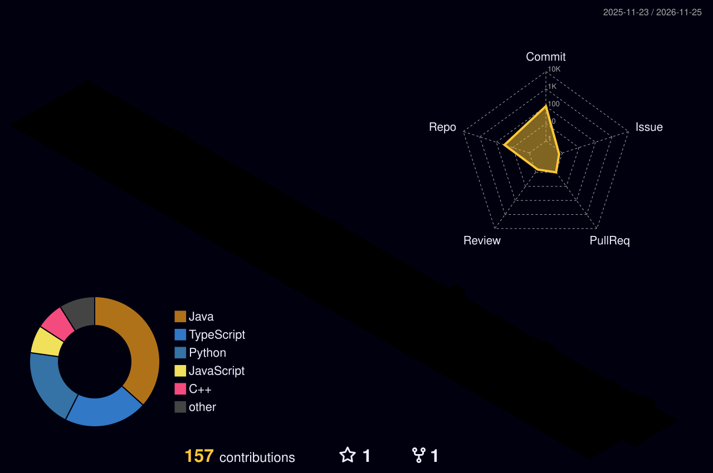

  

  <b>Estudante de Ciência da Computação na UFJF</b>. Construo aplicações web completas, do modelo de dados à interface, com código testado e bem organizado. 
  💼 Aberto a oportunidades de estágio/júnior em desenvolvimento

  

## 🚀 Projetos em destaque

| Projeto | O que é | Stack |
|---|---|---|
| [**Calcula Aí**](https://github.com/GustaRM/trab-engenharia-de-software) | Sistema web para pequenos empreendedores calcularem custo de produção e preço de venda, com autenticação e testes | Python, Flask, SQLAlchemy |
| [**MachWeb**](https://github.com/GustaRM/machweb) | Simulador visual de economias de jogos (fontes, conversores, portões e estoques), com testes unitários | React, TypeScript, Vitest |
| [**Ações de Extensão UFJF**](https://github.com/GustaRM/trab-ihc) | Plataforma para mapear e divulgar as ações de extensão da UFJF | Next.js, TypeScript, Tailwind |
| [**Coloração Defeituosa**](https://github.com/GustaRM/coloracao-defeituosa) | Heurísticas gulosa, randomizada e reativa para coloração de grafos, testadas em instâncias DIMACS | C++ |
| [**Segurança em Redes**](https://github.com/GustaRM/seguranca-em-redes) | Implementações de AES, Diffie-Hellman, cifra de Feistel, hash, OAuth2 e RBAC | Python |

## 📚 Estudando agora

Padrões de projeto em Java: Strategy, Observer, State, Visitor, Composite, Mediator e outros, cada um com exemplo e testes.

## 🧊 Minhas contribuições em 3D

  

